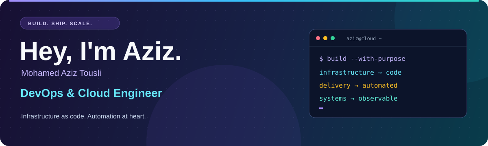

  

  <a href="https://www.linkedin.com/in/medaziztousli/"><strong>LinkedIn</strong></a>
  &nbsp; / &nbsp;
  <a href="https://medaziztousli.weebly.com"><strong>Portfolio</strong></a>
  &nbsp; / &nbsp;
  <a href="mailto:mohamedaziztousli@gmail.com"><strong>Email</strong></a>

## Infrastructure that teams can rely on

I'm **Aziz**, a polytechnic engineer from Tunisia focused on **DevOps, cloud infrastructure, and automation**. I build and operate AWS infrastructure, Kubernetes platforms, and delivery pipelines that help engineering teams ship and run their applications.

My background also spans Python services and data engineering, connecting the infrastructure layer to the workloads it supports.

### What I work on

- **Cloud & platforms** — Provision AWS infrastructure with Terraform; deploy containerized services with Kubernetes, Docker, and Helm; automate node scaling with Karpenter.
- **Delivery & automation** — Build GitLab CI/CD pipelines, apply GitOps practices, coordinate releases, and automate operational tasks with Ansible.
- **Reliability & observability** — Monitor services with Prometheus, Grafana, and Loki; improve incident response with alerts and runbooks; tune performance and cloud resource usage.

### Experience

**FinGenesis · DevOps Engineer & Project Manager** 
June 2020 – August 2025 · Singapore

Built and operated AWS and Kubernetes infrastructure, automated delivery workflows, and supported engineering teams with deployment tooling. Worked across observability, incident response, database recovery, performance tuning, and real-time data services.

**Mintore | CFM · Data Engineer** 
September 2025 – Present · Tunisia / France

Develop automated ETL and ingestion workflows with Python, AWS Lambda, and Apache Airflow, with scheduling, retries, monitoring, and data validation.

Earlier engineering experience

- **Devino · Graduation Intern** — January–June 2020. Kubernetes infrastructure on AWS, cluster security, Helm-based platform services, and monitoring.
- **I-care · Engineering Intern** — June–August 2019. Python API development, automated testing, and containerized delivery workflows.

### Toolkit

**Cloud & infrastructure** 
AWS · Terraform · Linux · Ansible

**Containers & delivery** 
Kubernetes · Docker · Helm · Kustomize · Karpenter · GitLab CI/CD · Git

**Observability** 
Prometheus · Grafana · Loki · Grafana OnCall

**Code & data** 
Python · FastAPI · Pytest · PostgreSQL · Redis · Kafka · Airflow

### Certifications & education

- **Certified Kubernetes Administrator (CKA)** · CNCF · June 2025
- **[AWS Certified Solutions Architect – Associate](https://www.credly.com/badges/5119338d-c3e4-464d-b695-13a5b440f46b/public_url)** · July 2024
- **[AWS Certified Cloud Practitioner](https://www.credly.com/badges/66f264f6-dd1a-46aa-9911-b34fe495da5d)** · December 2023

**École Polytechnique de Tunisie** · Polytechnic Engineer · 2017–2020

---

Interested in cloud platforms, infrastructure automation, or reliable delivery? **[Let's connect.](https://www.linkedin.com/in/medaziztousli/)**
